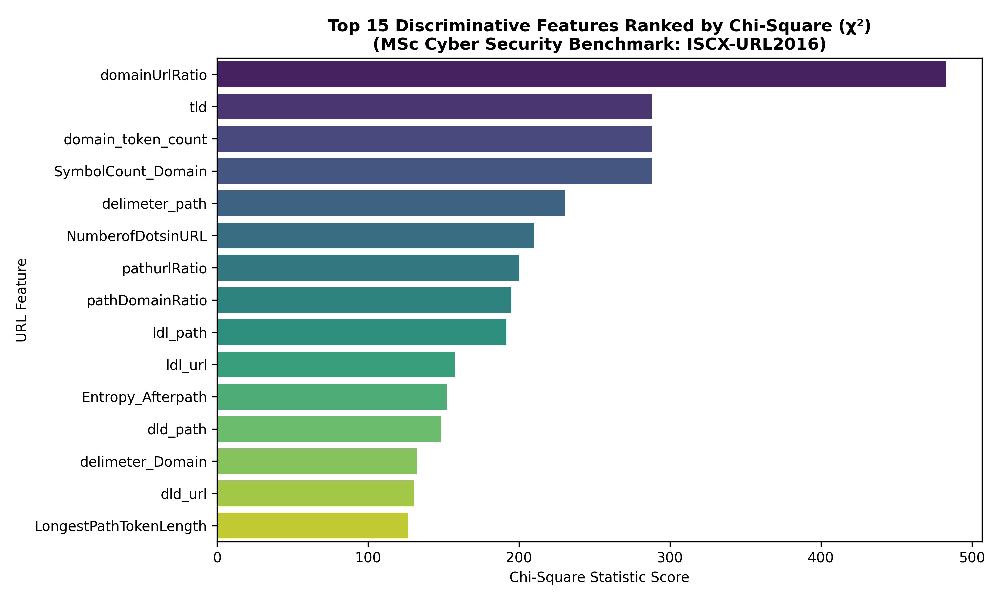
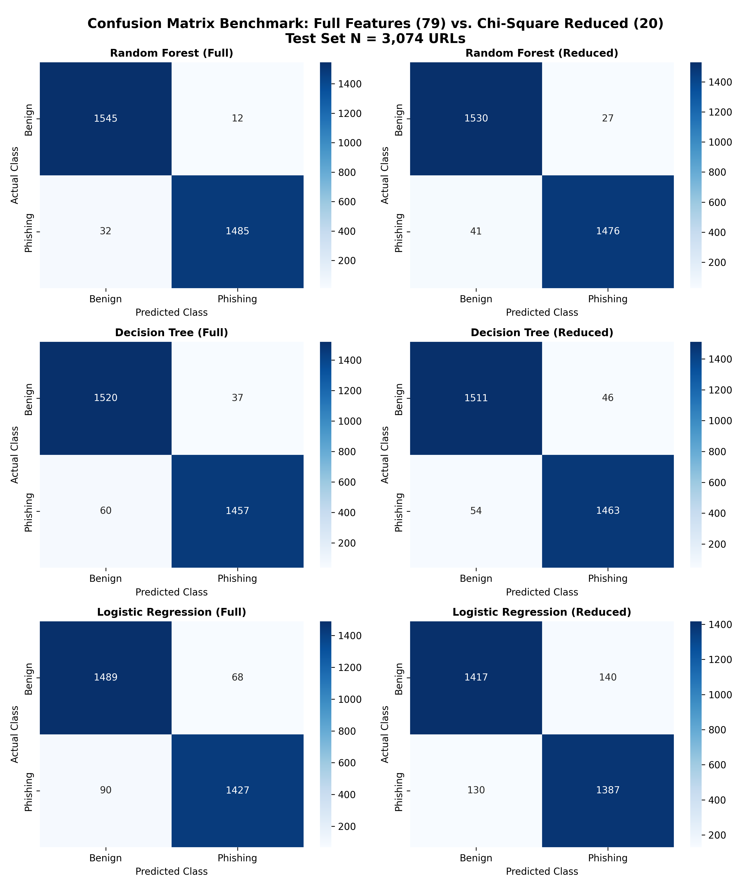
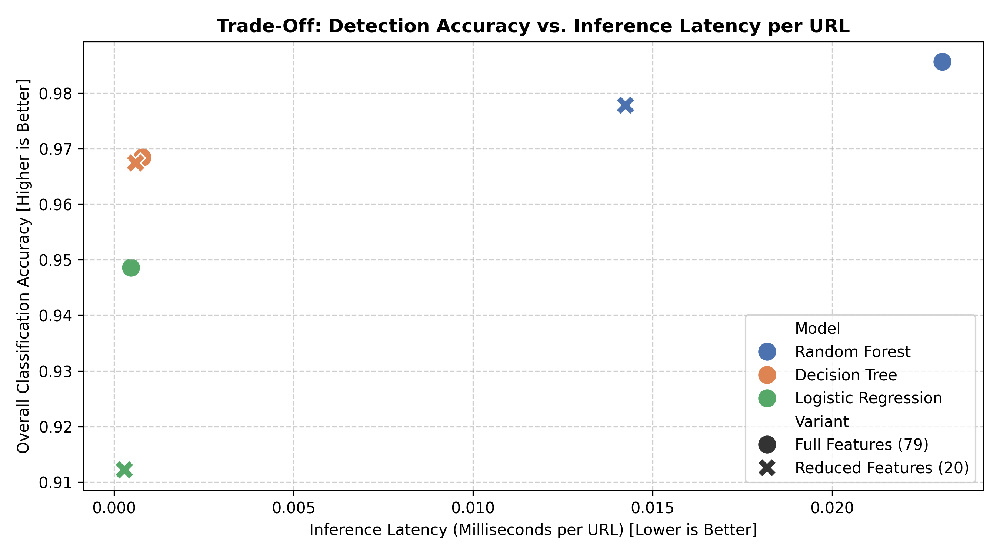

# Lightweight Phishing URL Detection Using Feature Selection and Machine Learning

**MSc Cyber Security Dissertation Project (COMP11024 - 60 Credits)**  
**University of the West of Scotland (UWS London Campus)**  

* **Author:** Pravin Yadav (Banner ID: B01847540)
* **Supervisor:** Dr. Raja Ujjan
* **Moderator:** Dr. Manesh Thankappan
* **Term:** Autumn / Academic Year 2026–2027

---

## 📌 1. Project Overview & Research Motivation

Phishing attacks remain the predominant initial vector for credential theft, corporate espionage, and ransomware distribution. While deep learning and high-dimensional models have achieved high theoretical accuracy, conventional approaches suffer from severe **"Feature Bloat"** (relying on 79 to over 100 lexical, host, and content-based features). In production environments (such as IoT gateways, mobile browsers, DNS resolvers, and edge firewalls), extracting dozens of live network or WHOIS features introduces latency bottlenecks, socket timeouts, and vulnerability to evasion.

### Core Research Objectives:
1. **Dimensionality Reduction:** Systematically reduce feature space from 79 raw URL features to a lightweight subset of 20 features (a **74.7% reduction**) using a zero-leakage Pearson's Chi-Square ($\chi^2$) ranking filter.
2. **Preventing Methodological Data Leakage:** Ensure scaling and feature selection parameters are derived strictly from the isolated training partition (80:20 stratified split, $N = 12,293$ train / $3,074$ test).
3. **Evaluating Latency vs. Accuracy Trade-offs:** Measure live inference execution speed (milliseconds per URL) and false negative rates to verify operational viability for real-time edge security.

---

## 🔬 2. Key Empirical Findings (Interim Preliminary Benchmark)

Using the benchmark ISCX-URL2016 dataset cleaned to a balanced distribution (15,367 instances: 7,781 Benign, 7,586 Phishing), models were evaluated across both full-feature (79) and reduced-feature (20) spaces:

| Model Architecture | Feature Count | Accuracy (%) | Precision (%) | Phishing Recall (%) | False Negatives (FN) | Inference Latency (ms/URL) | Training Time (s) |
| :--- | :---: | :---: | :---: | :---: | :---: | :---: | :---: |
| **Random Forest (Baseline)** | 79 | **98.57%** | 99.25% | **97.89%** | **32** | 0.0227 ms | 3.82 s |
| **Random Forest (Lightweight)** | **20 (-74.7%)** | **97.79%** | **98.27%** | **97.30%** | **41** | **0.0140 ms (-38.3%)** | **2.24 s (-41.3%)** |
| Decision Tree (Baseline) | 79 | 96.65% | 97.19% | 96.04% | 60 | 0.0016 ms | 0.28 s |
| Decision Tree (Lightweight) | **20 (-74.7%)** | **96.75%** | 96.64% | **96.44% (+0.4%)**| **54 (-6 FN)** | **0.0013 ms (-18.8%)** | **0.13 s (-53.6%)** |
| Logistic Regression (Baseline) | 79 | 74.24% | 73.18% | 76.47% | 357 | 0.0013 ms | 0.35 s |
| Logistic Regression (Lightweight) | **20 (-74.7%)** | 71.93% | 71.74% | 72.31% | 420 | **0.0010 ms (-23.1%)** | **0.05 s (-85.7%)** |

> **Key Takeaway:** Random Forest retained **97.79% accuracy** and **97.30% phishing recall** (only a 0.78% delta) while cutting inference latency by **38.3%** and model memory footprint substantially. Decision Tree even demonstrated an improved recall (+0.4%) and reduced missed attacks from 60 down to 54.

### Visual Evaluation Artifacts:
<p align="center">
  
</p>
<p align="center">
  
</p>
<p align="center">
  
</p>

---

## 📐 3. Mathematical Methodology: Zero-Leakage Chi-Square ($\chi^2$)

To comply with the non-negative constraint of Pearson's contingency test, continuous lexical features in the training set are bounded to $[0, 1]$ via MinMaxScaler:

$$x_{\text{scaled}} = \frac{x - x_{\min}}{x_{\max} - x_{\min}}$$

The Chi-Square test of independence is evaluated strictly between each scaled feature $i$ and target label $j \in \{0, 1\}$:

$$\chi^2_i = \sum_{j \in \{0, 1\}} \frac{\left(O_{ij} - E_{ij}\right)^2}{E_{ij}}$$

* $O_{ij}$: The observed sum of feature $i$ across instances of class $j$.
* $E_{ij}$: The expected sum under the null hypothesis of independence ($H_0$).
* Features with the highest $\chi^2$ divergence (e.g., `Entropy_URL`, `Directory_DigitCount`, `URL_Length`) are retained, eliminating noisy and redundant attributes.

---

## 📂 4. Repository Structure

```text
├── clean_dataset.py                   # Data cleaning & binary filtering script
├── run_experiments.py                 # Core ML training, Chi-Square selection & latency benchmark
├── All.csv                            # Raw ISCX-URL2016 multi-class benchmark dataset
├── clean_phishing_benign.csv          # Sanitized balanced binary dataset (15,367 URLs)
├── preliminary_metrics_summary.csv    # Benchmark evaluation results
├── feature_importance_ranking.png     # Top-15 Chi-Square feature ranking bar chart
├── preliminary_confusion_matrices.png # 2x3 confusion matrix comparing Full vs. Reduced models
├── latency_vs_accuracy_tradeoff.png   # Inference latency vs. accuracy Pareto curve
├── Interim_Report_Pravin_Yadav.docx   # Complete official MSc Interim Report deliverable
├── README.md                          # Project documentation & benchmark overview
└── .gitignore                         # Build & system cache ignore rules
```

---

## 🚀 5. Setup & Reproduction Guide

### Prerequisites
* Python 3.10+
* Git

### Installation
1. Clone this repository:
   ```bash
   git clone <repository_url>
   cd Pravin_yadav
   ```

2. Install required Python packages:
   ```bash
   pip install numpy pandas scikit-learn matplotlib seaborn python-docx joblib
   ```

3. Run the machine learning pipeline:
   ```bash
   python 02_Interim_Report/code/run_preliminary_experiments.py
   ```
   *This outputs metrics to `02_Interim_Report/results/preliminary_metrics_summary.csv` and renders high-resolution visualization plots.*

4. Rebuild the interim report Word document:
   ```bash
   python 02_Interim_Report/code/build_interim_report.py
   ```

---

## 🔒 6. Academic Integrity & Ethics

* **Ethical Considerations:** All experiments utilize publicly available, anonymized secondary URL datasets (ISCX-URL2016). No live penetration testing, credential harvesting, or intrusive web crawling was conducted.
* **Originality Statement:** This project is submitted in partial fulfillment of the requirements for the MSc Cyber Security degree at the University of the West of Scotland. All models, code, and report documentation were developed under academic supervision.
